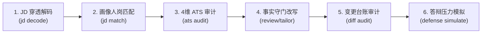
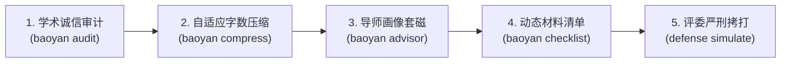

# OfferGet · 本地确定性求职审查与学术材料工程操作系统

<p align="center">
  <b>面向工业级技术求职与学术升学的本地规则型分析与材料工程平台</b><br>
  穿透解码 JD · 锚定单一事实真值源 · 拦截 AI 虚辞与伪精确吹嘘 · 模拟高压答辩攻防 · 驱动数据化投递与 Offer 决策
</p>

<p align="center">
  
  
  <a href="https://github.com/ZXJC-niusile/OfferGet/actions"></a>
  
  
  
  
  <a href="LICENSE"></a>
</p>

---

## 📖 目录 (Table of Contents)
- [🎯 解决的核心痛点](#-解决的核心痛点)
- [🌟 5 分钟极速上手：四大场景实操路线图](#-5-分钟极速上手四大场景实操路线图)
  - [场景 1：企业技术求职定制与面试通关（求职者首选）](#场景-1企业技术求职定制与面试通关求职者首选)
  - [场景 2：国内高校保研 / 考研复试 / 导师套磁（学术升学首选）](#场景-2国内高校保研--考研复试--导师套磁学术升学首选)
  - [场景 3：Offer 薪酬评估与 6 大合同陷阱博弈](#场景-3offer-薪酬评估与-6-大合同陷阱博弈)
  - [场景 4：独立简历排版神器（多主题、防跨页 A4 编译）](#场景-4独立简历排版神器多主题防跨页-a4-编译)
- [🤖 作为 AI 智能体 Skill 使用 (Antigravity / Gemini / Claude)](#-作为-ai-智能体-skill-使用-antigravity--gemini--claude)
- [🎨 简历排版画廊与主题生态 (12 种渲染主题)](#-简历排版画廊与主题生态-12-种渲染主题)
- [🏛️ 全景双轨架构拓扑 (Architecture)](#️-全景双轨架构拓扑-architecture)
- [📋 CLI 命令完整速查手册 (Cheat Sheet)](#-cli-命令完整速查手册-cheat-sheet)
- [📦 预置开箱测试用例索引 (`examples/`)](#-预置开箱测试用例索引-examples)
- [🧪 质量工程与全量自检 (652 项测试)](#-质量工程与全量自检-652-项测试)
- [🔒 核心设计哲学与安全护栏](#-核心设计哲学与安全护栏)

---

## 🎯 解决的核心痛点

在企业招聘内卷化与高校保研学术竞争白热化的今天，求职者与深造学子正面临双向信息不对称与信用挤压：

1. **企业端：JD 修辞虚构与“伪精确”吹嘘泛滥**：招聘启事充斥着公关套话，而大量候选人使用通用大模型生成充满 AI 腔调（如“深度赋能”、“完美闭环”、编造指标）的简历，遭遇 ATS 过滤系统与资深技术考官的“一票否决”。
2. **面试端：缺乏真实抗压与证据防守能力**：写在简历上的“主导架构”、“从 0 到 1”经不住技术总监或复试专家连续 3 轮白板追问与边界探针。
3. **学术端：保研学术失信与导师博弈风险**：夏令营报名系统存在严苛字数限制，学生常犯“在投论文虚报为已发表、单机仿真冒充硬件实测、动词越权”等学术不端红线；在联系导师时缺乏学术范式认知，容易遭遇口头承诺毁约（被鸽或鸽导师）。
4. **决策端：薪酬陷阱隐蔽与有效时薪失真**：大厂高薪往往包裹着严苛的“绩效对半拆分、期权 4 年悬崖、单边竞业、无效加班”，缺乏科学的多 Offer 真实时薪折算模型。

**OfferGet** 打造了一套 **“本地化、规则确定性、零幻觉” 的双轨操作系统**，让每一次求职与学术材料准备都有据可依、有数可查、抗辩抗漂移。

---

## 🌟 5 分钟极速上手：四大场景实操路线图

> 💡 **提示**：项目内置了完整的 `examples/` 示例数据。即使您还没准备好自己的简历 JSON，也可以直接复制下述命令运行，直观体验完整流水线！

### 场景 1：企业技术求职定制与面试通关（求职者首选）

如果您手头有**一份简历底稿**和一个**心仪岗位的 JD 招聘描述**，请按以下 6 步走完企业求职闭环：



#### 第 1 步：穿透解码目标岗位真实需求 (5 层图层 + 32 项潜台词)
不仅提取字面技能，更能识别“抗压能力强”、“扁平化管理”等潜台词背后的暗坑与业务真实痛点：
```bash
python cli.py jd decode examples/sample_ai_jd.txt
```

#### 第 2 步：计算人岗匹配度与关键技能缺口 (ROI 跃迁)
分析简历与 JD 的加权匹配分，并指出 50%~80% 关键错失区间的掌握周期与投入产出比：
```bash
python cli.py jd match examples/sample_ai_jd.txt --profile examples/candidate_profile.json
```

#### 第 3 步：执行 ATS 4 维可读性与反 AI 痕迹审计
从排版规范、技能契合、量化成果、**反 AI 指纹（拦截假大空废话与破折号）** 给出 100 分制评级：
```bash
python cli.py ats audit examples/candidate_profile.json --jd examples/sample_ai_jd.txt
```

#### 第 4 步：生成闭环改写建议并受控落地 (人机协同 HITL 提案)
所有润色建议先以草稿提案暂存，杜绝未经确认擅自篡改，结合指标抗漂移机制保真：
```bash
# 生成改写审查提案
python cli.py review examples/sample_ai_jd.txt --profile examples/candidate_profile.json --output review.json
```

#### 第 5 步：审计改写前后 Diff 台账 (确保每一条改动都有源可溯)
```bash
python cli.py diff audit examples/candidate_profile.json tailored_profile.json
```

#### 第 6 步：针对项目经历开启技术答辩攻防模拟
模拟技术总监进行连续 3 轮边界拷打，提前查漏补缺：
```bash
python cli.py defense simulate examples/candidate_profile.json --intensity critical
```

---

### 场景 2：国内高校保研 / 考研复试 / 导师套磁（学术升学首选）

针对清华、北大、华五等顶尖高校夏令营、预推免、九推与考研复试的严苛材料要求：



#### 第 1 步：学术经历 4 大诚信红线核查
严厉拦截“仿真冒充实测、单卡虚标集群、在投伪造录用、挂名冒充主导”等一票否决级红旗：
```bash
python cli.py baoyan audit "负责 8 卡 A100 集群分布式微调实验，实测吞吐提升 34.2%，成果已在投顶会。" \
  --role 核心成员 --tier 简历版
```

#### 第 2 步：自适应 3 级字数无损压缩
报名系统只有 100 字文本框？自适应压缩算法保证在不丢失主谓宾与实测数据的前提下按字数预算压缩：
```bash
# 压缩为高校报名系统适用的“摘要版 (80~120字)”
python cli.py baoyan compress examples/sample_baoyan_entry.txt --tier 摘要版

# 压缩为单页简历适用的“简历版 (180~250字)”
python cli.py baoyan compress examples/sample_baoyan_entry.txt --tier 简历版
```

#### 第 3 步：导师近 3 年学术画像匹配与高情商套磁信
解析导师论文范式演进，计算研究契合度，生成告别公式化废话的真诚外联邮件：
```bash
python cli.py baoyan advisor examples/sample_advisor.json \
  --profile examples/academic_profile.json \
  --scenario summer_camp
```

#### 第 4 步：生成 21 项动态材料合规核对清单
根据申报阶段（夏令营/预推免/九推/统考复试）与身份（直博/学硕/专硕）动态生成专属材料自查表：
```bash
python cli.py baoyan checklist --profile examples/academic_profile.json --stage 夏令营 --track 直博
```

#### 第 5 步：复试面试“严刑拷打”式红蓝攻防
输入学术项目，开启最高烈度的复试专家挑刺追问：
```bash
python cli.py defense simulate examples/academic_profile.json --intensity hell
```

---

### 场景 3：Offer 薪酬评估与 6 大合同陷阱博弈

拿到一个或多个 Offer 之后，帮助您看穿“假高薪”，制定谈判筹码：

```bash
# 1. 评估薪酬包结构，测算真实有效时薪，并扫描 6 大劳动合同陷阱（试用期打折、无效加班、苛刻竞业等）
python cli.py offer evaluate examples/sample_offer.json --profile examples/candidate_profile.json

# 2. 生成中英双语、带量化论据的高情商 Counter-Offer 薪酬争取邮件与口头对谈脚本
python cli.py offer counter examples/sample_offer.json --target-base 95000 --profile examples/candidate_profile.json
```

---

### 场景 4：独立简历排版神器（多主题、防跨页 A4 编译）

哪怕您不需要进行复杂的 JD 分析，仅想排版一份**高颜值、严禁多出 3 行导致尴尬空白跨页**的专业简历，OfferGet 的排版引擎也是极致利器：

```bash
# 1. 使用经典大厂工程师主题编译 (生成 HTML 与 PDF)
python cli.py resume build examples/candidate_profile.json --theme classic-tech

# 2. 编译学术推免专属 LaTeX 模版 (输出 .tex 源码并自动编译为 PDF)
python cli.py resume build examples/academic_profile.json --theme academic-latex

# 3. 编译下一代高颜值 Typst 模版
python cli.py resume build examples/academic_profile.json --theme academic-typst

# 4. 强制严格 1 页，DOM 像素级 AutoFit 紧凑压制
python cli.py resume build examples/candidate_profile.json --theme modern-navy --pages 1

# 5. 内容较少时开启呼吸感自适应填充 (避免底部出现大面积空荡)
python cli.py resume build examples/candidate_profile.json --theme modern-navy --adaptive-fill

# 6. 生成脱敏版本 (隐藏真实手机、邮箱与公司名，适合开源分享或公开展示)
python cli.py resume build examples/candidate_profile.json --anonymize strict
```

---

## 🤖 作为 AI 智能体 Skill 使用 (Antigravity / Gemini / Claude)

OfferGet 不仅是一个 CLI 工具，更是一个符合现代智能体标准的 **Agent Skill**。配置后，您可以直接在 AI 聊天框中用**纯自然语言**操作所有功能！

### 1. 挂载安装 (只需 1 条命令)
在支持 Antigravity / Gemini CLI 的环境中，通过软链接将仓库挂载为全局技能：
* **Windows (PowerShell)**：
  ```powershell
  New-Item -ItemType Junction -Path "$HOME\.gemini\config\skills\offerget" -Target "你的本地路径\OfferGet"
  ```
* **macOS / Linux**：
  ```bash
  ln -s "/path/to/OfferGet" "$HOME/.gemini/config/skills/offerget"
  ```

### 2. 自然语言交互范例
挂载后，您无需记忆任何 CLI 参数，直接对 AI 提问即可：
* 💬 *“用 offerget 帮我解析这段阿里后端 JD，看看里面的技术潜台词和暗坑。”*
* 💬 *“基于 examples/candidate_profile.json，为我做一次 4 维 ATS 审计与防伪核验。”*
* 💬 *“这段项目经历我想投清华夏令营，帮我做学术诚信审查，并压缩成 100 字左右的摘要版。”*
* 💬 *“针对我的这个大模型推理加速项目，开启‘严刑拷打’烈度的答辩攻防模拟。”*
* 💬 *“用 classic-tech 主题把我的简历编译成 HTML 和 PDF，强制单页压页。”*

---

## 🎨 简历排版画廊与主题生态 (12 种渲染主题)

OfferGet 内置 12 套生产级排版主题，完美覆盖工业求职、学术升学与海外申请全场景：

| 主题名称 (`--theme`) | 渲染引擎 | 适用人群与场景风格 | 核心排版特色 |
| :--- | :---: | :--- | :--- |
| `classic-tech` | HTML/PDF | 互联网大厂技术岗、后端/算法/全栈 | 经典灰黑底蕴、紧凑信息密度、标配 Bullet 树 |
| `modern-navy` | HTML/PDF | 现代科技独角兽、外企、前沿技术岗 | 优雅海军蓝主题色、模块化徽章、现代排版栅格 |
| `silicon-clean` | HTML/PDF | 硅谷外企、开源社区、国际化团队 | 极简留白、西文衬线微调、GitHub 徽标集成 |
| `asu-dense` | HTML/PDF | 经历丰富的高年资工程师、全栈专家 | 极限信息密度、双列紧凑布局、最大化空间利用 |
| `sidebar-clean` | HTML/PDF | 产品经理、项目经理、综合复合型人才 | 左右不对称分栏、技能/证书可视化侧边栏 |
| `academic-postgraduate`| HTML/PDF | 国内保研、考研复试、高校求职 | 中文宋体/黑体严谨规范、强调科研论文与获奖位次 |
| `engineering-sb2nov` | HTML/PDF | 经典 Overleaf 极客圈风靡模板复刻 | 纯正 LaTeX 经典质感 HTML 完美复刻 |
| `modern-corporate` | HTML/PDF | 国央企、金融科技、传统企业技术部 | 严谨庄重商务风、正规证件照卡位、层次分明 |
| `ats-plain` | Text/HTML | ATS 投递直通车、猎聘/Boss/Workday | 零 CSS 干扰、纯粹文本树、100% 机器解析穿透 |
| `academic-latex` | XeLaTeX | 计算机/数学系海外申请、学术夏令营 | 原生 XeLaTeX 编译，支持公式、宏包与顶会排版 |
| `academic-typst` | Typst | 新一代高性能学术排版爱好者 | 毫秒级极速编译、现代化现代排版美学 |
| `ats-docx` | Word DOCX| 猎头报备、国企内部审批系统 | 兼容 Microsoft Word，标准化表格与段落结构 |

---

## 🏛️ 全景双轨架构拓扑 (Architecture)

```text
┌────────────────────────────────────────────────────────────────────────────────────────────────────────────────────────────────────────┐
│                                              OfferGet Dual-Track Master Operating System                                               │
├────────────────────────────────────────────────────────┬───────────────────────────────────────────────────────────────────────────────┤
│                  【轨道一：企业求职与改写闭环】                 │                             【轨道二：国内学术推免与保研复试】                  │
├──────────────────────────┬─────────────────────────────┼──────────────────────────┬──────────────────────────┬─────────────────────────┤
│   Module 1: JDAnalyst    │    Module 2: ApexResume     │   Module 3: ATSAuditor   │  Module 4: Privacy & Fact│  Module 5: Strategy & Nego
├──────────────────────────┼─────────────────────────────┼──────────────────────────┼──────────────────────────┼─────────────────────────┤
│ • 5 图层纵向语义穿透拆解    │ • 单事实源 (SSOT) 凭证账本   │ • 4 维加权 ATS 评分模型  │ • 双向可逆去隐私化脱敏网关│ • 技能差距 ROI 杠杆计算  │
│ • 32 项大厂黑话潜台词词典  │ • Mini-RFC 架构叙事改写     │ • 三态技能台账防伪审查   │ • 标准/严格双层脱敏引擎  │ • 50-80% 错失区间跃迁建议│
│ • 5 大技术红旗与反问探针   │ • 动词五级阶梯与证据约束    │ • 可见度系统多变体隔离   │ • 事实锚点提取与虚标拦截 │ • 6 大劳动合同陷阱深度识别│
│ • Top 20 硬核面试真题库   │ • AutoFit 像素级压页算法    │ • 四大反 AI 指纹拦截过滤 │ • 指标漂移 (Anti-Drift)   │ • 高情商薪酬博弈与反制谈判│
│ • 渠道权重与 Ghost Job   │ • 12 套生产级渲染主题       │ • 成对双胞胎双语合规核验 │ • 确定性真实底稿核验门禁 │ • 中英双语薪酬对谈策略信 │
├──────────────────────────┴─────────────────────────────┴──────────────────────────┴──────────────────────────┴─────────────────────────┤
│                                                【学术升学、人机协同与底层支撑基石】                                                      │
├────────────────────────────────────────────────────────────────────────────────────────────────────────────────────────────────────────┤
│ • Academic Baoyan: 四大学术诚信红线核查、自适应三层字数弹性压缩引擎 (摘要版/简历版/陈述版)、高校导师画像匹配与高情商套磁信                │
│ • Red-Blue Defense: 真实经历项目答辩攻防模拟器 (先热个身/开始挑刺/严刑拷打 3 级烈度)、7 节 Markdown 攻防报告生成                        │
│ • HITL Proposals & Store: 基于 SQLite (offers.db) 的 6 阶段投递看板追踪、受控材料提案 (Proposal Accept/Reject)、版本 SHA-256 元数据签名  │
│ • Interop Engine: 与业界生态 RenderCV 双向无缝转换，支持导入/导出标准化简历 JSON                                                        │
└────────────────────────────────────────────────────────────────────────────────────────────────────────────────────────────────────────┘
```

---

## 📋 CLI 命令完整速查手册 (Cheat Sheet)

以下是 OfferGet 提供的 **26 个核心命令入口** 与常用参数速查：

### 1. 岗位画像与 JD 分析 (`offerget jd`)
| 命令 | 核心参数与选项 | 功能说明 |
| :--- | :--- | :--- |
| `python cli.py jd decode <jd.txt>` | `[--json]` | 5 图层穿透解码 JD，输出技术栈、潜台词与技术红旗 |
| `python cli.py jd match <jd.txt>` | `--profile <path> [--json]` | 计算候选人画像与 JD 的加权匹配分及雷达分析 |
| `python cli.py jd report <jd.txt>` | `--profile <path> [--output <file>]` | 生成中英双语战略战报 HTML |

### 2. 简历审计与防伪质检 (`offerget ats` / `fact` / `diff`)
| 命令 | 核心参数与选项 | 功能说明 |
| :--- | :--- | :--- |
| `python cli.py ats audit <profile>` | `[--jd <file>] [--tag <tag>] [--json]` | 4 维 ATS 综合打分，包含反 AI 指纹拦截与虚标过滤 |
| `python cli.py ats ledger <profile>` | `--jd <file> [--json]` | 生成 Verified / Claimed / Gap 三态技能台账 |
| `python cli.py fact verify <text>` | `--profile <path> [--json]` | 严格比对经历陈述与真实底稿，拦截指标虚标夸大 |
| `python cli.py diff audit <base>` | `<tailored> [--output-dir <dir>]` | 比对改写前后的事实变更，生成 Diff 溯源台账 |

### 3. 多主题简历排版与编译 (`offerget resume`)
| 命令 | 核心参数与选项 | 功能说明 |
| :--- | :--- | :--- |
| `python cli.py resume build <profile>`| `--theme <name> [--pages 1/2/auto]` | 编译指定主题的 HTML 与 PDF 简历 |
| | `[--adaptive-fill] [--anonymize strict]` | 开启呼吸感间距自适应填充，或双向脱敏导出 |
| `python cli.py resume audit` | `--claims <json> --html <html_path>` | 确定性凭证防伪核验 |
| `python cli.py resume autofit <in>` | `<out.html> [--pdf <out.pdf>]` | 像素级单页压页紧凑化与 PDF 导出 |

### 4. 学术推免与保研复试 (`offerget baoyan`)
| 命令 | 核心参数与选项 | 功能说明 |
| :--- | :--- | :--- |
| `python cli.py baoyan audit <text>` | `[--role <身份>] [--tier 简历版]` | 4 大学术诚信红线审查与字数合规检测 |
| `python cli.py baoyan compress <txt>`| `--tier 摘要版/简历版/陈述版` | 针对系统字数限制进行三级自适应弹性压缩 |
| `python cli.py baoyan advisor <adv>` | `--profile <path> [--scenario camp]` | 导师研究方向契合度计算与高情商自荐信 |
| `python cli.py baoyan checklist` | `[--profile <path>] [--stage 夏令营]` | 生成包含 21 项物料的动态合规自查清单 |

### 5. 项目答辩红蓝攻防 (`offerget defense`)
| 命令 | 核心参数与选项 | 功能说明 |
| :--- | :--- | :--- |
| `python cli.py defense simulate` | `<profile> [--intensity hell]` | 模拟技术考官或复试专家展开 3 轮压力拷打模拟 |

### 6. 投递追踪与人机协同 (`offerget application` / `proposal` / `review`)
| 命令 | 核心参数与选项 | 功能说明 |
| :--- | :--- | :--- |
| `python cli.py review <jd.txt>` | `--profile <path> [--output <file>]` | 端到端全流程审查闭环，生成改写提案草稿 |
| `python cli.py proposal list` | `[--status draft] [--db <file>]` | 查看待人工确认的改写建议提案 |
| `python cli.py proposal accept <id>` | `--profile <path> --jd <file> --output <new>`| 人工显式接受提案，生成新版 Profile 并自动编译 |
| `python cli.py application add <id>` | `--company <name> --role <role>` | 新建求职投递记录，录入跟踪看板 |
| `python cli.py application status` | `<id> <interview/offer/closed>` | 流转投递看板状态机 |
| `python cli.py application outcome` | `<id> --stage interview --result rejected`| 录入面试结果、复盘反思与标签洞察 |

### 7. Offer 薪酬博弈与合同分析 (`offerget offer`)
| 命令 | 核心参数与选项 | 功能说明 |
| :--- | :--- | :--- |
| `python cli.py offer evaluate <offer>`| `[--profile <path>] [--json]` | 真实时薪折算，扫描 6 大劳动合同陷阱 |
| `python cli.py offer counter <offer>` | `--target-base <薪资> [--profile <path>]`| 生成高情商薪酬争取邮件与口头谈判对谈话术 |

### 8. 系统自检与生态互通 (`offerget doctor` / `selftest` / `rendercv`)
| 命令 | 核心参数与选项 | 功能说明 |
| :--- | :--- | :--- |
| `python cli.py doctor` | *(无参数)* | 检查 Python 运行环境、无头浏览器与可选排版工具 |
| `python cli.py selftest` | *(无参数)* | 执行全系统 652 项自动化测试套件自检 |
| `python cli.py rendercv import <in>` | `--output profile.json` | 将 RenderCV JSON 导入转换为 OfferGet Profile |
| `python cli.py rendercv export <in>` | `--output rendercv.json` | 将 OfferGet Profile 导出为标准 RenderCV JSON |

---

## 📦 预置开箱测试用例索引 (`examples/`)

仓库自带真实场景的高质量测试数据集，位于 [`examples/`](file:///D:/User%20Hub/GitHub/OfferGet/examples/) 目录下：

* **`candidate_profile.json`**：互联网技术候选人完整档案（包含工作经历、开源项目、量化指标）。
* **`sample_ai_jd.txt`**：国内头部大厂 AI / 分布式后端架构师真实招聘 JD 文本。
* **`academic_profile.json`**：985 高校计算机学子标准保研/学术简历数据（科研项目、顶会投稿、学科竞赛）。
* **`sample_advisor.json`**：国家级重点实验室博导学术画像（含近 3 年重点论文与范式演进）。
* **`sample_baoyan_entry.txt`**：典型的学术经历申报文本段落（包含仿真、在投等典型边界测试场景）。
* **`sample_offer.json`**：包含底薪、期权、绩效对半拆分及竞业条款的典型真实 Offer 结构。

---

## 🧪 质量工程与全量自检 (652 项测试)

OfferGet 追求航空级的代码可靠性与工业级稳健度：

```bash
# 1. 环境依赖诊断
python cli.py doctor

# 2. 运行系统级统一自检流水线 (OfferGet 618 项 + ApexResume 34 项 = 652 项 100% 绿灯)
python cli.py selftest

# 3. 运行端到端全链路集成测试 (E2E Integration)
python -m pytest tests/test_e2e_pipeline.py -v

# 4. 运行全量单元测试
python -m pytest tests -q
```

---

## 🔒 核心设计哲学与安全护栏

1. **单事实真值源（SSOT）**：`CandidateProfile` 与实测材料是唯一底稿，所有润色与提炼均为派生视图，绝不自动篡改或编造未发生的数据。
2. **人机协同人工确认门禁（HITL）**：所有改写建议以草稿形态（Proposal）存在，必须经过求职者显式执行 `proposal accept` 才能入库并编译。
3. **隐私至上与本地计算**：内置标准与严格两级双向脱敏网关，全部数据在用户本地计算机完成计算与存储，无惧个人隐私与商业机密泄露。
4. **恪守学术道德与合规底线**：系统技术性拦截一切伪造学历、编造虚假实验、篡改在投论文状态等不端行为；所有劳动法律提示均附带合规指引。

---

## 📄 许可证 (License)

本项目遵循 **[CC BY-NC-SA 4.0](LICENSE)** (知识共享 署名-非商业性使用-相同方式共享 4.0 国际) 协议开源。

> **免责声明**：OfferGet 致力于提升求职者与升学学子的真实表达质量与职场信息对称度。系统提供的匹配得分、时薪测算、合同陷阱提示及防守策略仅作为个人材料准备与决策辅助工具，不构成任何形式的法律建议、保研录取承诺或招聘保证。用户对其提交的一切申请材料真实性与法律后果负全责。
