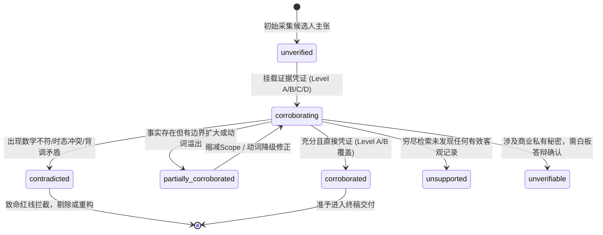

# 原子主张事实台账规范（Claim Ledger Schema & Specification）

在工业级技术简历锻造体系中，简历文案的防伪上限不取决于形容词的多寡，而取决于**底层原子事实台账（Atomic Claim Ledger）的确定性与可检验性**。

传统简历撰写往往充斥着大量混杂了**职责、方法、指标与因果归因**的复合长句。当面试官就其中某一细节展开深度技术追问时，往往由于某一维度的失实或证据断裂，导致候选人全盘崩塌。本规范定义了复合陈述的 4 维原子拆解法则、标准 JSON Schema 规范、以及证据追踪与置信度状态机。

---

## 目录索引

1. [一、 复合陈述的 4 维原子拆解原则](#一一-复合陈述的-4-维原子拆解原则)
2. [二、 典型复合语句拆解实战案例](#二二-典型复合语句拆解实战案例)
3. [三、 JSON Schema 规范定义](#三三-json-schema-规范定义)
4. [四、 证据追踪与置信度状态机](#四四-证据追踪与置信度状态机)
5. [五、 面试防御准备金（Defense Readiness）闭环](#五五-面试防御准备金defense-readiness闭环)

---

## 一、 复合陈述的 4 维原子拆解原则

任何一段高势能的技术经历描述，其底层必须能够严密正交解耦为以下 4 个原子主张维度：

```text
┌─────────────────────────────────────────────────────────────────────────┐
│                      复合简历陈述 (Compound Statement)                   │
└────────────────────────────────────┬────────────────────────────────────┘
                                     │
         ┌───────────────────────────┼───────────────────────────┐
         ▼                           ▼                           ▼
┌──────────────────┐        ┌──────────────────┐        ┌──────────────────┐
│  1. 职责主张      │        │  2. 方法主张      │        │  3. 指标主张      │
│  (Role Claim)    │        │  (Method Claim)  │        │  (Metric Claim)  │
│ 动词等级与边界Scope │        │ 技术选型与参数链路 │        │ 分子/分母/基线/口径 │
└──────────────────┘        └──────────────────┘        └──────────────────┘
                                     │
                                     ▼
                            ┌──────────────────┐
                            │  4. 因果归因主张   │
                            │ (Causal Claim)   │
                            │ 收益直接归因与排他 │
                            └──────────────────┘
```

### 1.1 职责主张 (Role / Responsibility Claim)
- **定义**：候选人在该技术事项中所承担的真实角色与控制边界。
- **层级约束**：严格遵循动词五级阶梯：
  $$\text{支持/协助 (Level 1)} < \text{参与 (Level 2)} < \text{负责 (Level 3)} < \text{推动 (Level 4)} < \text{主导 (Level 5)}$$
- **门禁要求**：
  - 声称 Level 4（推动）或 Level 5（主导/从0到1）时，**必须提供方案决策（Decision-Making）与规划牵引（Planning）证据**；
  - 必须给出严密的**最小可证明闭环 (Minimal Proving Scope)**，严禁无边界的“负责全公司大模型平台”。

### 1.2 方法主张 (Methodology / Technical Claim)
- **定义**：候选人为达成目标所采取的具体工程路径、算法方案与参数设计。
- **门禁要求**：
  - 拒绝假大空的“引入先进算法”、“采用前沿架构”；
  - 必须包含具象的技术名词、选型对比（Trade-off）、调用链路或核心参数（如“短 CoT 截断”、“多候选拒绝采样”、“微压缩沙箱”）。

### 1.3 指标主张 (Metric / Impact Claim)
- **定义**：技术方案上线或评测产出的客观量化成果。
- **门禁要求**：
  - 杜绝无基线浮夸提升（如“性能翻倍”、“大幅优化”）；
  - 明确标定计算口径（相对提升 vs 绝对百分点提升）；
  - 保留分子与分母（如 `420/500`），零分母与零基线无条件拦截；
  - 标注数据深度等级（D0-D4）与成果证据等级（R0-R3）。

### 1.4 因果归因主张 (Causal Attribution Claim)
- **定义**：量化指标的提升确实由上述方法主张直接导致，而非系统大盘自然增长、硬件基座升级或他团队红利。
- **门禁要求**：
  - 能够指明反事实基线（Counterfactual Baseline）与对照组（Control Group）；
  - 明确排除混杂变量（Confounding Factors）干扰（如“剔除了模型并发扩容带来的吞吐增益，纯算法推理延迟降低 40%”）。

---

## 二、 典型复合语句拆解实战案例

### 原始复合陈述
> “主导基于 GRPO 的长推理大模型对齐，通过短 CoT 优化与双重拒绝采样，在 GSM8K 上将准确率由 68.0% 提升至 82.5%，推动线上推理端到端 P99 延迟降低 40%。”

### 4 维原子拆解台账

| 原子主张 ID | 维度类型 | 原子主张内容 | 对应事实凭证与证据等级 | 潜在防御卡点与核验标准 |
|:---|:---|:---|:---|:---|
| **CLM-01-ROLE** | 职责主张 | 主导推理强化学习算法选型，确定采用 GRPO 替代 PPO 的方案决策 | Level A: 内部技术方案评审 RFC 纪要、Git Commit 提交记录（Level 5 需方案决策证据） | 必须能讲清为什么选 GRPO 舍弃 PPO？价值模型（Critic）的显存瓶颈如何计算？ |
| **CLM-01-METH** | 方法主张 | 实现动态 Short CoT 格式约束过滤，并设计双重拒绝采样（Dual Rejection Sampling）管道 | Level B: 仓库核心算法模块代码实现、配置文件参数（Top-p=0.95, Temp=0.7） | 拒绝采样的打分器是什么？单条样本重试几次？截断长度是多少 token？ |
| **CLM-01-METR** | 指标主张 | 在标准 GSM8K 测试集上，Pass@1 准确率从 68.0% 提升至 82.5%（绝对提升 14.5pp，相对提升 21.3%） | Level B: 离线评测日志、WandB 实验曲线、标准 Benchmark 复现脚本 | 评测时用的是 8-shot 还是 0-shot？是 Greedy 还是 maj@k？ |
| **CLM-01-ATTR** | 因果归因 | P99 延迟降低 40% 直接源于 Short CoT 带来的平均输出 Token 长度缩减（由 1200 降至 720），而非调度层优化 | Level C: 推理引擎 Token 输出统计面板与 A/B 切片对比报表 | 若面试官追问是否由 vLLM 升级导致，需明确指出平均推理步数减少的直接证据。 |

---

## 三、 JSON Schema 规范定义

OfferGet 统一采用严谨的 JSON Schema 校验台账文件（`claims.json` 或 `claim-ledger.json`）：

```json
{
  "$schema": "https://json-schema.org/draft/2020-12/schema",
  "title": "OfferGetClaimLedger",
  "description": "Schema for Atomic Claim Ledger used in technical resume verification",
  "type": "object",
  "required": ["version", "candidate", "claims"],
  "properties": {
    "version": {
      "type": "string",
      "enum": ["1.0", "2.0"]
    },
    "candidate": {
      "type": "string",
      "description": "Candidate full name"
    },
    "target_role": {
      "type": "string",
      "description": "Target job title / engineering level"
    },
    "claims": {
      "type": "array",
      "items": {
        "$ref": "#/$defs/AtomicClaim"
      }
    }
  },
  "$defs": {
    "AtomicClaim": {
      "type": "object",
      "required": ["id", "text", "atomic_type", "verification_status"],
      "properties": {
        "id": {
          "type": "string",
          "pattern": "^CLM-[0-9]{2,4}-(ROLE|METH|METR|ATTR)$"
        },
        "text": {
          "type": "string",
          "description": "Raw statement or refined atomic assertion"
        },
        "atomic_type": {
          "type": "string",
          "enum": ["role", "methodology", "metric", "causal_attribution"]
        },
        "role_claimed": {
          "type": "string",
          "description": "The exact verb or role title claimed"
        },
        "verb_level": {
          "type": "integer",
          "minimum": 1,
          "maximum": 5,
          "description": "1:支持/协助, 2:参与, 3:负责, 4:推动, 5:主导"
        },
        "ground_truth_role_level": {
          "type": "integer",
          "minimum": 0,
          "maximum": 5,
          "description": "Verified actual level from background evidence"
        },
        "scope": {
          "type": "string",
          "description": "Bounded minimal proving scope"
        },
        "has_decision_evidence": {
          "type": "boolean",
          "description": "True if candidate possesses explicit architecture/planning decision proof"
        },
        "data_depth_level": {
          "type": "string",
          "enum": ["D0", "D1", "D2", "D3", "D4"],
          "description": "D0:描述统计, D1:诊断归因, D2:探索关联, D3:预测建模, D4:决策自适应"
        },
        "result_evidence_level": {
          "type": "string",
          "enum": ["R0", "R1", "R2", "R3"],
          "description": "R0:理论预估, R1:离线基准, R2:灰度测试, R3:生产实效"
        },
        "metric": {
          "type": ["object", "null"],
          "properties": {
            "numerator": { "type": "number" },
            "denominator": { "type": "number" },
            "displayed_percent": { "type": "number" },
            "baseline": { "type": "number" },
            "result": { "type": "number" },
            "reported_change_percent": { "type": "number" },
            "change_type": {
              "type": "string",
              "enum": ["relative", "percentage_points"]
            },
            "unit": { "type": "string" }
          }
        },
        "evidence": {
          "type": "object",
          "properties": {
            "source_level": {
              "type": "string",
              "enum": ["A", "B", "C", "D"]
            },
            "reference_uri": { "type": "string" },
            "commit_hash": { "type": "string" },
            "description": { "type": "string" }
          }
        },
        "verification_status": {
          "type": "string",
          "enum": [
            "unverified",
            "corroborating",
            "corroborated",
            "partially_corroborated",
            "contradicted",
            "unsupported",
            "unverifiable"
          ]
        },
        "confidence": {
          "type": "string",
          "enum": ["high", "medium", "low"]
        },
        "interview_defense": {
          "type": "object",
          "properties": {
            "l1_headline": { "type": "string" },
            "l2_tradeoff": { "type": "string" },
            "l3_whiteboard_deepdive": { "type": "string" },
            "trap_questions": {
              "type": "array",
              "items": { "type": "string" }
            }
          }
        }
      }
    }
  }
}
```

---

## 四、 证据追踪与置信度状态机

每一个原子主张从初始采集到最终交付，必须经过置信度状态机的确定性流转。

### 4.1 状态转移图



### 4.2 状态转移触发条件判定表

| 初始状态 | 迁移动作 | 目标状态 | 判定逻辑准则 |
|:---|:---|:---|:---|
| `unverified` | 引入证据源 | `corroborating` | 关联了至少一个 Level A/B/C/D 证据，正在执行交叉对比。 |
| `corroborating` | 证据完全闭环 | `corroborated` | 具备 Level A/B 凭证，且动词等级 $\le$ 真实等级，数学重算误差 $<0.5\%$。 |
| `corroborating` | 发现边界夸大 | `partially_corroborated` | 发现做的是协助却声称主导，或未界定 Scope。要求降级后重新校验。 |
| `corroborating` | 发现确凿冲突 | `contradicted` | 分子分母计算矛盾、时态完成态违规、或外部证据直接否定主张。 |
| `corroborating` | 穷尽检索无果 | `unsupported` | 涉及“全网第一”、“最年轻”等极端词，无任何权威第一方证据支持。 |
| `corroborating` | 商业机密受限 | `unverifiable` | 内部私有代码无法公开，自动挂起并打上白板推演问询卡。 |

### 4.3 置信度（Confidence）判定矩阵

置信度由**证据源等级**与**核验状态**共同决定：

| 证据源等级 | corroborated | partially_corroborated | unverifiable | unsupported / contradicted |
|:---|:---:|:---:|:---:|:---:|
| **Level A (第一方法定记录)** | `HIGH` | `MEDIUM` | 不适用 | `HIGH` (判定造假确凿) |
| **Level B (公开可复现记录)** | `HIGH` | `MEDIUM` | 不适用 | `HIGH` (无法复现) |
| **Level C (第三方报道)** | `MEDIUM` | `LOW` | 不适用 | `MEDIUM` |
| **Level D (私有口头声称)** | `LOW` | `LOW` | `LOW` | `LOW` |

---

## 五、 面试防御准备金（Defense Readiness）闭环

台账中的每一个已核验证明（`corroborated`），都自动生成三层防御卡（Defense Card）：

1. **Layer 1（5 秒扫视层 - Headline）**：
   - 提取参数级核心名词与指标（如：`GRPO 对齐`、`GSM8K 82.5% (+14.5pp)`、`P99 -40%`）。
2. **Layer 2（2 分钟技术方案答辩层 - Trade-off）**：
   - 面试官：“为什么用 Short CoT，怎么避免模型推理能力受损？”
   - 答辩要点：“我们在 GSM8K 上测试了 5 种截断阈值，发现 720 token 处能够保留 98% 的完整推理链，同时截断无效长尾废话。”
3. **Layer 3（15 分钟白板推演层 - Deep Dive & Trap）**：
   - 面试官：“如果在采样中遇到连续 5 次 Reward 为 0，梯度更新怎么防止崩溃？”
   - 答辩要点：“我们在 Loss 中加入了动态温度衰减因子，并在 Batch 维度执行混合负采样，代码位于评测沙箱核心模块。”
